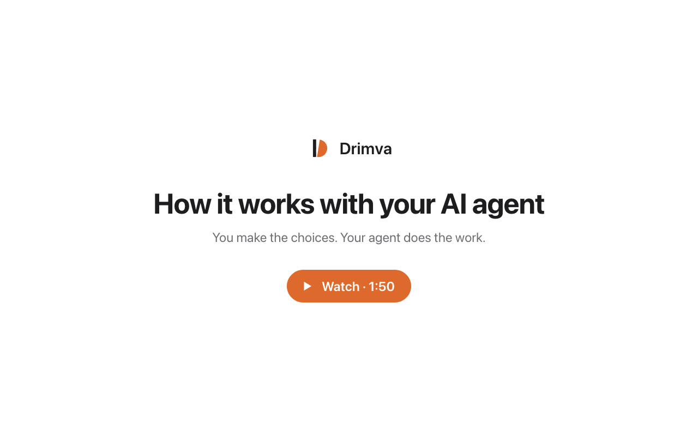

# Drimva skill

Let your AI agent run your job search. [Drimva](https://drimva.com) lists about 130,000 open US full-time jobs and internships from the career sites of more than 2,000 companies. It checks each job on the company's site every day and serves the catalog in a form agents can read.

[](https://drimva.com/agent)

## What your agent does

1. Reads your resume and picks search terms from Drimva's keyword lists.
2. Searches the catalog and scores each job from 0 to 100 against your background. Jobs whose posting states a condition you don't meet, such as visa sponsorship or a security clearance, are dropped.
3. Asks where you want to work, your minimum pay and similar choices, showing how many jobs each answer keeps.
4. Gives you a shortlist page. You pick the jobs.
5. Reads each picked job's application form and asks you only for answers it doesn't have.
6. If you want, tailors your resume to each job. Every change is shown with the line it replaces, for you to keep or undo. The workflow forbids adding experience, dates, numbers or skills you don't have.
7. Fills in the forms on the company's own site, when the agent has browser tools such as Claude in Chrome. You review and submit, or you tell the agent it may submit the jobs you picked.

The whole workflow is at [drimva.com/llms.txt](https://drimva.com/llms.txt). The skill points your agent there, so it always follows the current version.

## Install in Claude Code

```text
/plugin marketplace add JonnesLin/drimva-skill
/plugin install drimva@drimva
```

Then ask, for example, "Help me find a job that fits my resume" or "Find machine learning internships in California".

To install the skill by hand instead:

```bash
mkdir -p ~/.claude/skills/drimva && curl -fsSL https://raw.githubusercontent.com/JonnesLin/drimva-skill/main/skills/drimva/SKILL.md -o ~/.claude/skills/drimva/SKILL.md
```

## Install in Codex, Cursor or Gemini CLI

They read skills from `~/.agents/skills`:

```bash
mkdir -p ~/.agents/skills/drimva && curl -fsSL https://raw.githubusercontent.com/JonnesLin/drimva-skill/main/skills/drimva/SKILL.md -o ~/.agents/skills/drimva/SKILL.md
```

Or use the [skills.sh](https://skills.sh) installer: `npx skills add JonnesLin/drimva-skill`

## Use it without installing anything

Any agent that can read websites can use Drimva. Paste this into Claude Code, Codex or another agent:

```text
Read https://drimva.com/llms.txt and follow its job-search workflow to help me find a job.
```

## MCP connector

Assistants that support remote MCP servers can connect to `https://drimva.com/mcp`. You sign in with Google and choose whether the assistant may write. Tools, permissions and limits: [drimva.com/connector](https://drimva.com/connector).

## Your account and your data

- Searching needs no account.
- With a free account (Google sign-in), your agent saves shortlists and application progress on Drimva. You create an agent token on the [Account page](https://drimva.com/account) and give it to your agent once.
- Your resume and application materials stay in your agent's workspace, such as `~/job-search` for an agent on your computer. Drimva stores shortlist reasons and progress notes.
- Question pages, where the agent collects your answers on a web page, are invitation-only for now. Without them, the agent asks in chat.
- [Privacy](https://drimva.com/privacy) · [Terms](https://drimva.com/terms)

## License

MIT
